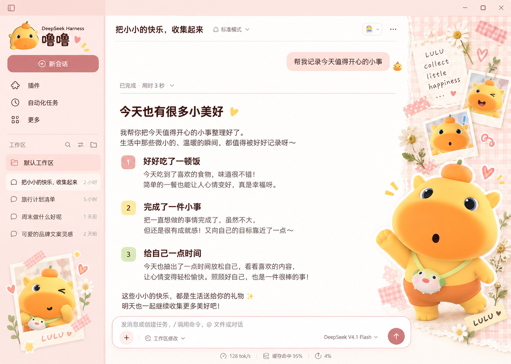

# 噜噜 · 桃粉手账

版本：1.0.0。为 DeepSeek Harness 制作的独立界面主题。



桃粉侧栏、奶油白阅读区、独立噜噜拍立得和右侧手账拼贴。真实会话、工作区、模型选择、附件及编辑器均由 DSH 提供；图片不包含任何模拟聊天控件。

## 安装

**GitHub 安装：**在 DSH → 插件 → 添加插件中粘贴仓库地址：

```text
https://github.com/dingfz-cyber/dsh-theme-lulu-journal
```

**ZIP 安装：**从 [v1.0.0 发布页](https://github.com/dingfz-cyber/dsh-theme-lulu-journal/releases/tag/v1.0.0)下载安装包。

解压安装包到长期保留的目录，在 DSH → 插件 → 添加插件中填写包含 `package.json` 的目录。停用其他主题，再启用「噜噜 · 桃粉手账」。本地路径安装后保留目录，不要移动或删除。

## 布局保护

- 侧栏列宽、拖动手柄、折叠行为和宽度保存由 DSH 控制。
- 历史列表先分配空间，底部装饰可缩小，短窗口中自动隐藏。
- 正文使用原生无头像助手排版，聊天与编辑器继续正常滚动。
- 保留官方底部固定遮罩，遮挡输入框及状态栏后方的聊天文字。
- 右侧人物来自唯一装饰图层，不叠加两套半透明人物。
- 聊天区域不足 900px 宽时隐藏右侧装饰，将空间还给正文。
- 主题停用会释放 token 覆盖、观察器、监听器及自有节点，不读取或修改聊天数据。

## 构建和验证

需要 Node.js 20 或以上，无额外 npm 依赖。

```text
npm run build
npm run check
npm run verify
```

素材及 CSS 嵌入 `lib/client.js`，使用主题时不从网络加载图片。包内图标符合 DSH 的 256 KiB 限制。

设计原图为视觉参考。会话标题、消息、时间、账号及菜单保持真实内容，随窗口比例变化自动调整装饰。
